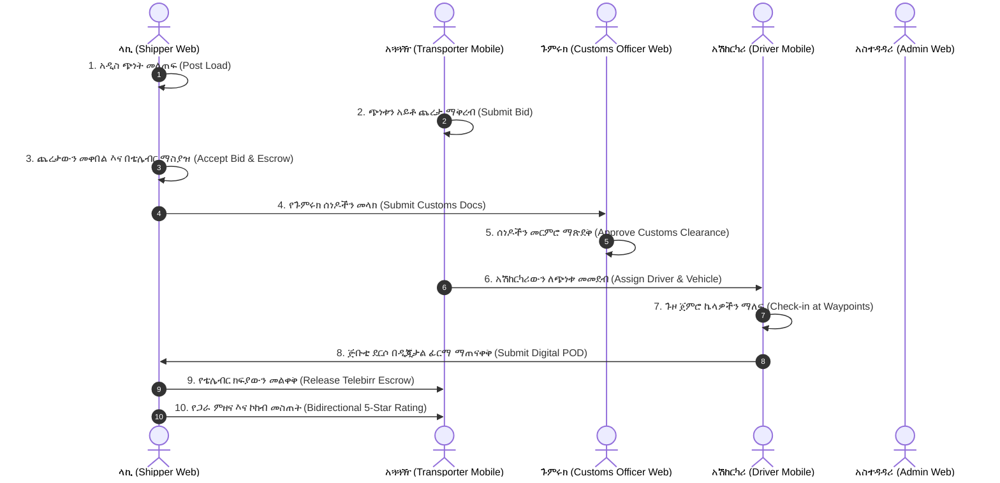

# 🇪🇹 TradeFlow v2 — የተሟላ የሁሉም ሚናዎችና ታቦች ማስተር መፈተሻ መመሪያ (Master End-to-End Testing Guide)

ይህ ሰነድ **TradeFlow** የተሰኘውን የኢትዮ-ጅቡቲ ስማርት የጭነት ትራንስፖርትና ሎጂስቲክስ ፕላትፎርም **ሁሉንም 6 ሚናዎች (Roles)**፣ **እያንዳንዱን ታቦቻቸውን (Tabs)** እና **ከጫፍ እስከ ጫፍ ያለውን የተሟላ የስራ ሂደት (End-to-End Workflow)** ደረጃ በደረጃ ለመፈተሽ የተዘጋጀ የተሟላ ማስተር ሰነድ ነው።

---

## 🔑 1. የሁሉም ሚናዎች ዝግጁ የመግቢያ መረጃዎች (Active Database Credentials)

በዳታቤዙ ውስጥ አስቀድመው የተረጋገጡ (Verified) 6ቱ ተጠቃሚዎች መረጃዎች፦

> **ሁለንተናዊ የሙከራ ይለፍ ቃል (Master Demo Password)፦**  
> ለሁሉም አካውንቶች **`Demo1234!`** (ለአድሚን **`Admin2024!`** ወይም **`Demo1234!`**) ይሰራል!

| # | ሚና (Role) | ሙሉ ስም | መለያ ስልክ / ኢሜይል | የይለፍ ቃል | መድረክ (Platform) | ቀጥታ አድራሻ (Direct URL) |
|---|:---|:---|:---|:---:|:---:|:---|
| **1** | **Shipper (የጭነት ባለቤት)** | hakim gezawe | `0922222222` ወይም `bekio9668@gmail.com` | `Demo1234!` | Web App | [http://localhost:3000/shipper](http://localhost:3000/shipper) |
| **2** | **Freight Forwarder (አስተላላፊ)** | dawit | `0933333333` ወይም `aliexpress2553@gmail.com` | `Demo1234!` | Web App | [http://localhost:3000/forwarder](http://localhost:3000/forwarder) |
| **3** | **Customs Officer (የጉምሩክ መርማሪ)** | Inspector Kebede Worku | `+251944556677` ወይም `kebede@miaoda.com` | `Demo1234!` | Web App | [http://localhost:3000/customs](http://localhost:3000/customs) |
| **4** | **System Admin (ዋና አስተዳዳሪ)** | TradeFlow Admin | `+251900000001` ወይም `admin@miaoda.com` | `Admin2024!` | Web App | [http://localhost:3000/admin](http://localhost:3000/admin) |
| **5** | **Transporter (አጓጓዥ ድርጅት)** | Bereket Sahlemariam | `0925537199` ወይም `bereket2553@gmail.com` | `Demo1234!` | Mobile App | Expo Go (`localhost:8081`) |
| **6** | **Driver (የከባድ መኪና አሽከርካሪ)** | Mesfin | `0911111111` ወይም `bereketsahlemariam701@gmail.com` | `Demo1234!` | Mobile App | Expo Go (`localhost:8081`) |

---

## 🌐 ክፍል 1፦ የጭነት ባለቤት ፖርታል (SHIPPER PORTAL — 13 ታቦች)

* **የመግቢያ አድራሻ፦** [http://localhost:3000/login](http://localhost:3000/login)  
* **መለያ፦** `0922222222` ወይም `bekio9668@gmail.com` | **የይለፍ ቃል፦** `Demo1234!`

### 🔹 ታብ 1.1: Dashboard — አጠቃላይ ዳሽቦርድ (`/shipper/dashboard`)
1. **የሚታዩ መረጃዎች፦**
   - 4 የቁልፍ መለኪያ ካርዶች፦ ንቁ ጭነቶች (Active Shipments)፣ በመጠባበቅ ላይ ያሉ ዋጋዎች (Pending Quotes)፣ የተሟሉ ሰነዶች (Documents Compliant)፣ እና በኤስክሮው የተጠበቀ ገንዘብ (Escrow Protected)።
   - የቀጥታ የኢትዮ-ጅቡቲ ኮሪደር ቴሌማቲክስ ሚኒ-ካርታ (Live Corridor Telematics Map)።
   - የቅርብ ጊዜ ጭነቶች ሰንጠረዥ (Recent Consignments Register)።
2. **የመፈተሻ እርምጃ፦**
   - ከላይ በስተቀኝ ያለውን **"+ አዲስ ጭነት መዝግብ"** ቁልፍ ተጫን፤ በቀጥታ ወደ ጭነት መመዝገቢያ ታብ እንደሚወስድ አረጋግጥ።

---

### 🔹 ታብ 1.2: Post Load — አዲስ ጭነት መመዝገቢያ (`/shipper/post-load`)
1. **የሚገቡ ትክክለኛ የሙከራ መረጃዎች (Test Inputs)፦**
   - **የጭነቱ ርዕስ (Cargo Title)፦** `Specialty Export Yirgacheffe Coffee Beans`
   - **ምድብ (Category)፦** `AGRICULTURAL_COFFEE`
   - **ክብደት (Total Weight in Tons)፦** `24.0`
   - **ይዘት (Volume in CBM)፦** `52.0`
   - **መነሻ ቦታ (Origin Location)፦** `Addis Ababa (Kaliti Export Depot)`
   - **መድረሻ ቦታ (Destination)፦** `Djibouti Doraleh Port Container Terminal`
   - **የታሰበ በጀት (Target Budget)፦** `185,000` ETB
   - **ልዩ ጥንቃቄዎች (Special Handling)፦** `Moisture Sensitive` እና `Customs Bonded` ምረጥ።
2. **የስፖት ዋጋ ማስያ ሞተር ፍተሻ (Dynamic Spot Rate Assistant)፦**
   - ሲስተሙ በራሱ የቀኑን የናፍጣ ዋጋና የኮሪደሩን ርቀት አስልቶ የሚመከር ስፖት ዋጋ (የዝቅተኛ ወለል እና የጣሪያ ገደብ) ሲያወጣ ተመልከት።
   - **"ይህንን ስፖት ዋጋ እንደ በጀት ተጠቀም"** የሚለውን ተጫን፤ በጀቱ ላይ በራስ-ሰር ይሞላል።
3. **የመፈተሻ እርምጃ፦**
   - **"ጭነት መዝግብ / Publish Consignment"** የሚለውን ሰማያዊ ቁልፍ ተጫን።
4. **የሚጠበቅ ውጤት፦**
   - አረንጓዴ የማረጋገጫ መልዕክት ይወጣል፤ ጭነቱ ዳታቤዝ ገብቶ በ Consignments ታብ ላይ ወዲያውኑ ይታያል።

---

### 🔹 ታብ 1.3: Consignments — የጭነቶች መዝገብ (`/shipper/consignments`)
1. **የመፈተሻ እርምጃ፦**
   - በ Search ሳጥኑ ላይ `Coffee` ወይም የጭነቱን መለያ ፈልግ።
   - ማጣሪያዎችን ሞክር፦ `ሁሉም (All)`፣ `ክፍት (Open)`፣ `በጉዞ ላይ (In Transit)`፣ `የደረሱ (Delivered)`።
   - ጭነቱ ላይ **"ዝርዝር መረጃ (View Details)"** የሚለውን ተጫን፤ የመንገዱን ካርታ እና ዝርዝር መግለጫ መመልከትህን አረጋግጥ።

---

### 🔹 ታብ 1.4: Bids — የቀረቡ የዋጋ ጨረታዎች (`/shipper/bids`)
1. **የመፈተሻ እርምጃ፦**
   - አጓጓዦች ለለጠፍካቸው ጭነቶች ያቀረቧቸውን የዋጋ ማወዳደሪያዎች ተመልከት።
   - የቀረበውን ዋጋ (ETB)፣ የአጓጓዡን የደህንነት ደረጃ (Stars) እና የፍሊት ብዛት አወዳድር።
   - **"ጨረታውን ተቀበል (Accept Bid)"** የሚለውን ተጫን፤ ጭነቱ ከአጓጓዡ ጋር ተሳስሮ ወደ ኤስክሮው ክፍያ እንደሚሸጋገር አረጋግጥ።

---

### 🔹 ታብ 1.5: Live Tracking Map — የቀጥታ የጂፒኤስ ካርታ (`/shipper/tracking`)
1. **የመፈተሻ እርምጃ፦**
   - በይነተገናኝ የካርታ ገጹን ተመልከት (Leaflet Interactive Map)።
   - በኮሪደሩ ላይ ያሉ ቁልፍ ኬላዎችን (Galafi Border, Semera, Awash, Modjo Dry Port, Kaliti) በካርታው ላይ ተመልከት።
   - የተሽከርካሪውን የቀጥታ ፍጥነት (km/h)፣ የቀረውን የነዳጅ መጠን (%) እና የሚደርስበትን ሰዓት (Predictive ETA ± 20 mins) አረጋግጥ።

---

### 🔹 ታብ 1.6: Route Optimization — የመስመር ማመቻቸት (`/shipper/route-optimization`)
1. **የመፈተሻ እርምጃ፦**
   - በኮሪደሩ ያሉ 3 ዋና አማራጮችን አወዳድር፦
     1. **ዋናው የሀገር አቀፍ አውራ ጎዳና ኤ-1 (በጋላፊ በኩል)**
     2. **የደቡባዊ አማራጭ ኮሪደር (በደወሌ በኩል) [✨ የተመረጠ]**
     3. **የኢትዮ-ጅቡቲ የባቡር መስመር (EDR የኤሌክትሪክ ባቡር)**
   - የከፍታ መረጃዎችን፣ የመንገድ ጥራቶችን እና የነዳጅ ማደያዎችን ክምችት ተመልከት።
   - በደወሌ በኩል ያለውን መስመር መርጠህ የመስመር ለውጥ ማረጋገጫ መልዕክት መምጣቱን ፈትሽ።

---

### 🔹 ታብ 1.7: Documents — የጉምሩክ ሰነዶች ፍተሻ (`/shipper/documents`)
1. **የመፈተሻ እርምጃ፦**
   - 4ቱን ዓለም አቀፍ የንግድ ሰነዶች ተመልከት፦
     1. *Commercial Invoice (የንግድ ደረሰኝ)*
     2. *Packing List (የዕቃ ዝርዝር)*
     3. *Bill of Lading (የባህር/የየብስ ጭነት ሰነድ)*
     4. *Certificate of Origin (የመነሻ ምስክር ወረቀት)*
   - **"ሰነዶችን አስቀድመህ ፈትሽ (Run Pre-Submission Check)"** የሚለውን ተጫን፤ ሲስተሙ የክብደትና የዋጋ ወጥነትን አመሳክሮ አረንጓዴ የብቃት ምልክት ሲሰጥ ተመልከት።
   - ወደ ጉምሩክ መርማሪው ወረፋ ላክ።

---

### 🔹 ታብ 1.8: Payments & Escrow — የቴሌብር ክፍያና ኤስክሮው (`/shipper/payments`)
1. **የመፈተሻ እርምጃ፦**
   - በቴሌብር ስማርት ኤስክሮው የተያዘውን ገንዘብ (Held in Escrow) ተመልከት።
   - የቴሌብር ክፍያ መስኮትን ከፍተህ የክፍያ ሂደቱን ሞክር።
   - ጭነቱ በሰላም ሲደርስ **"ክፍያ ልቀቅ (Release Escrow)"** ተጭነህ ገንዘቡ ለአጓጓዡ መተላለፉን አረጋግጥ።
   - ችግር ካለ **"አለመግባባት ሪፖርት አድርግ (Raise Dispute)"** የሚለውን ሞክር።

---

### 🔹 ታብ 1.9: Contract Rates & Pricing — የኮንትራት ዋጋዎች (`/shipper/pricing`)
1. **የመፈተሻ እርምጃ፦**
   - የረጅም ጊዜ የኮንትራት ዋጋ መቆለፊያዎችን (Locked Contract Rates) ተመልከት።
   - የነዳጅ ዋጋ ሲጨምር ከስፖት ዋጋ ጋር ከ 20% በላይ ልዩነት ሲያሳይ የሚመጣውን የማስጠንቀቂያ ባጅ አረጋግጥ።

---

### 🔹 ታብ 1.10: Fuel Analytics — የነዳጅ ፍጆታ ትንተና (`/shipper/fuel-analytics`)
1. **የመፈተሻ እርምጃ፦**
   - የተገመተውን እና በትክክል የፈሰሰውን የነዳጅ መጠን በየጉዞው አወዳድር።
   - ነዳጅ ቆጣቢ ምርጥ ጉዞዎችን (Fuel Saving Outliers) እና ከፍተኛ ብክነት የታየባቸውን ጉዞዎች ተመልከት።
   - የኮሪደር ክፍሎች እና የመኪና ሞዴሎች የነዳጅ ብቃት ንጽጽር ሰንጠረዥን ፈትሽ።

---

### 🔹 ታብ 1.11: Risk & Security Zones — የስጋት ቀጠናዎችና አማራጭ መንገድ (`/shipper/security-zones`)
1. **የመፈተሻ እርምጃ፦**
   - **ታብ 1 (Proactive Geofence Alerts)፦** በ 25 ኪ.ሜ ክልል ውስጥ ያሉ ንቁ ማስጠንቀቂያዎችን ተመልከት።
   - **ታብ 2 (Risk Zone Database)፦** ምንም የሞክ ዳታ እንደሌለና «ምንም የተመዘገበ የስጋት ቀጠና የለም» የሚለውን አረንጓዴ ባጅ ተመልከት። **"+ አዲስ ቀጠና መዝግብ"** የሚለውን ተጭነህ እውነተኛ የስጋት ቀጠና መዝግብ፤ ከዚያም በቆሻሻ መጣያ አዝራሩ (Trash) ሰርዘው።
   - **ታብ 3 (Alternate Routing Matrix)፦** በጋላፊ እና በደወሌ በኩል ያለውን የ 162 ደቂቃ የጊዜ ቁጠባ ማትሪክስ ተመልከት።

---

### 🔹 ታብ 1.12: Transporter Performance — የአጓጓዦች ብቃት ትንተና (`/shipper/performance`)
1. **የመፈተሻ እርምጃ፦**
   - አጓጓዦች በሰዓቱ የማድረስ ምጣኔ (On-Time Delivery Rate %)፣ የደህንነት ውጤት (Safety Index) እና የተከናወኑ ጉዞዎችን ተመልከት።

---

### 🔹 ታብ 1.13: Ratings & Reviews — አስተያየቶችና ምዘናዎች (`/shipper/ratings`)
1. **የመፈተሻ እርምጃ፦**
   - ጉዞው ከተጠናቀቀ በኋላ ለአጓጓዡ ከ 1 እስከ 5 ኮከብ እና የጽሁፍ አስተያየት ስጥ።

---

## 🏢 ክፍል 2፦ የጭነት አስተላላፊ ፖርታል (FREIGHT FORWARDER — 4 ታቦች)

* **የመግቢያ አድራሻ፦** [http://localhost:3000/login](http://localhost:3000/login)  
* **መለያ፦** `0933333333` ወይም `aliexpress2553@gmail.com` | **የይለፍ ቃል፦** `Demo1234!`

### 🔹 ታብ 2.1: Multi-Shipper Dashboard (`/forwarder/dashboard`)
1. **የመፈተሻ እርምጃ፦**
   - በርካታ የላኪ ደንበኞችን (Multiple Shippers) የጭነት ሁኔታ በአንድ የተጠቃለለ ዳሽቦርድ ላይ ተመልከት።

### 🔹 ታብ 2.2: Load Consolidation — የጋራ ጭነት ማሰባሰቢያ (`/forwarder/consolidation`)
1. **የመፈተሻ እርምጃ፦**
   - አነስተኛ የሆኑ ከፊል ጭነቶችን (LTL - Less-Than-Truckload) ወደ አንድ ሙሉ ኮንቴነር (FTL - Full-Truckload) በማዋሃድ የቦታና የክብደት አጠቃቀምን (Payload Optimization) ሞክር።

### 🔹 ታብ 2.3: Customs Coordination — የጉምሩክ ቅንጅት (`/forwarder/customs`)
1. **የመፈተሻ እርምጃ፦**
   - የበርካታ ደንበኞችን ሰነዶች በአንድ ጊዜ (Batch Filing) ወደ ጉምሩክ የማስገባት ሂደትን ፈትሽ።

### 🔹 ታብ 2.4: Multi-Modal Tracking — የባለብዙ ትራንስፖርት ዳሰሳ (`/forwarder/tracking`)
1. **የመፈተሻ እርምጃ፦**
   - ከጅቡቲ ወደብ በባቡር ➔ ሞጆ ደረቅ ወደብ በከባድ መኪና ➔ አዲስ አበባ መጋዘን ያለውን የሁለገብ ትራንስፖርት ቅብብሎሽ ተመልከት።

---

## 🛃 ክፍል 3፦ የጉምሩክ መርማሪ ፖርታል (CUSTOMS OFFICER — 3 ታቦች)

* **የመግቢያ አድራሻ፦** [http://localhost:3000/login](http://localhost:3000/login)  
* **መለያ፦** `+251944556677` ወይም `kebede@miaoda.com` | **የይለፍ ቃል፦** `Demo1234!`

### 🔹 ታብ 3.1: Document Verification Queue — የፍተሻ ወረፋ (`/customs`)
1. **የመፈተሻ እርምጃ፦**
   - በላኪዎች የተላኩ የጉምሩክ ሰነዶችን የፍተሻ ወረፋ ተመልከት።
   - በኬላዎች አጣራ፦ ሞጆ ደረቅ ወደብ፣ ጋላፊ ድንበር፣ ቃሊቲ፣ ደወሌ።

### 🔹 ታብ 3.2: Side-by-Side Review — ጎን ለጎን ሰነድ መመርመሪያ
1. **የመፈተሻ እርምጃ፦**
   - በአንዱ ሰነድ ላይ **"መርምር / Review"** ተጫን፤ ደረሰኙን፣ የዕቃ ዝርዝሩን እና የባህር ሰነዱን ጎን ለጎን አወዳድር።
   - አውቶሜትድ የስጋት ማንቂያዎችን (Discrepancy Alerts) ፈትሽ።

### 🔹 ታብ 3.3: Clearance Decision — ይፋዊ ውሳኔ መስጫ
1. **የመፈተሻ እርምጃ፦**
   - **"አጽድቅ (Approve & Clear)"** ተጫን፤ ሰነዱ የጸደቀበትን የጉምሩክ ማህተም እና ሁኔታ ወደ `CLEARED` ይቀይረዋል።
   - ወይም **"ማስተካከያ ጠይቅ (Request Revision)"** የሚለውን መርጠህ ማስታወሻ አስቀምጥ።

---

## ⚙️ ክፍል 4፦ የስርዓት አስተዳዳሪ ፖርታል (ADMIN CONSOLE — 5 ታቦች)

* **የመግቢያ አድራሻ፦** [http://localhost:3000/login](http://localhost:3000/login)  
* **መለያ፦** `+251900000001` ወይም `admin@miaoda.com` | **የይለፍ ቃል፦** `Admin2024!`

### 🔹 ታብ 4.1: Verification Queue — የተጠቃሚዎች ማረጋገጫ (`/admin/verification`)
1. **የመፈተሻ እርምጃ፦**
   - አዳዲስ ተጠቃሚዎች ያስገቧቸውን የንግድ ፈቃድ (Trade License)፣ የግብር ከፋይ ቁጥር (TIN) እና የመኪና ሰነዶች ተመልከት።
   - **"Verify / አጽድቅ"** ተጫን፤ ተጠቃሚው ወደ `VERIFIED` እንዲሸጋገር አድርግ።

### 🔹 ታብ 4.2: Dispute Resolution — የአለመግባባት ሽምግልና (`/admin/disputes`)
1. **የመፈተሻ እርምጃ፦**
   - በላኪ እና በአጓጓዥ መካከል የተፈጠሩ የክፍያ አለመግባባቶችን ተመልከት።
   - የዲጂታል ርክክብ ሰነዱን (POD) እና የጉዞውን የጂፒኤስ ዳታ መርምረህ ውሳኔ ስጥ፦
     * *ገንዘቡን ለአጓጓዡ ልቀቅ (Release to Transporter)*
     * *ወይም ለላኪው መልስ (Refund to Shipper)*

### 🔹 ታብ 4.3: Health Monitoring — የሲስተም ጤንነት (`/admin/health`)
1. **የመፈተሻ እርምጃ፦**
   - የኤፒአይ ምላሽ ፍጥነት (Latency)፣ የዳታቤዝ ግንኙነት እና የቴሌማቲክስ ዥረት ሁኔታን ተመልከት።

### 🔹 ታብ 4.4: Fraud Detection — የማጭበርበር መቆጣጠሪያ (`/admin/fraud`)
1. **የመፈተሻ እርምጃ፦**
   - ተደጋጋሚ የግብር ቁጥሮች (Duplicate TINs) እና አጠራጣሪ የጨረታ ቅንጅቶችን መርምር።

### 🔹 ታብ 4.5: Audit Logs — የስርዓት መዝገብ (`/admin/audit`)
1. **የመፈተሻ እርምጃ፦**
   - በሲስተሙ የተከናወኑ የዋጋ ስሌቶች፣ የሰነድ ማጽደቆች እና የገንዘብ ዝውውሮች የታሪክ መዝገብን ፈትሽ።

---

## 📱 ክፍል 5፦ የአጓጓዥ ሞባይል ፖርታል (TRANSPORTER MOBILE — 5 ታቦች)

* **መድረክ፦** TradeFlow Mobile App (React Native Expo)  
* **መለያ፦** `0925537199` ወይም `bereket2553@gmail.com` | **የይለፍ ቃል፦** `Demo1234!`

### 🔹 ታብ 5.1: Fleet Tab — የተሽከርካሪዎች አስተዳደር (`FleetTab.tsx`)
1. **የመፈተሻ እርምጃ፦**
   - የአጓጓዡን የጭነት መኪናዎች ተመልከት (ለምሳሌ፦ ታርጋ `ASHHS333`፣ የቦክስ ትራክ)።
   - **"Assign Driver / አሽከርካሪ መድብ"** ተጫን፤ አሽከርካሪ መስፍንን (`0911111111`) ለመኪናው መድብ።
   - አዲስ ተሽከርካሪ መመዝገብ መቻልህን ፈትሽ።

### 🔹 ታብ 5.2: Loads Tab — ክፍት ጭነቶች መፈለጊያ (`LoadsTab.tsx`)
1. **የመፈተሻ እርምጃ፦**
   - ላኪዎች የለጠፏቸውን ክፍት የኮሪደር ጭነቶች በካርጎ አይነት፣ በመነሻና በመድረሻ ፈልግ።
   - የጭነቱን ዝርዝር መረጃ ተመልከት።

### 🔹 ታብ 5.3: Bidding Tab — ጨረታ ማቅረቢያ (`BiddingTab.tsx`)
1. **የመፈተሻ እርምጃ፦**
   - በአንዱ ጭነት ላይ የዋጋ ጨረታ አቅርብ (የማጓጓዣ ዋጋ በብር፣ የሚነሳበት ቀን እና የአጓጓዥ ማስታወሻ)።
   - የቀረበው ጨረታ በላኪው ዳሽቦርድ ላይ መታየቱን አረጋግጥ።

### 🔹 ታብ 5.4: Earnings Tab — ገቢና ሂሳብ (`EarningsTab.tsx`)
1. **የመፈተሻ እርምጃ፦**
   - የተጣራ ገቢ (Net Payout)፣ የፕላትፎርም ኮሚሽን ቅናሽ (5%) እና በኤስክሮው የተያዘ ገንዘብን ተመልከት።

### 🔹 ታብ 5.5: Overview & Language — መገለጫና ቋንቋ (`OverviewTab.tsx`)
1. **የመፈተሻ እርምጃ፦**
   - የተረጋገጠ የአጓጓዥ መገለጫን ተመልከት።
   - ከላይ ያለውን የቋንቋ መቀየሪያ በመጫን አፑን ወደ **አማርኛ**፣ **ኦሮምኛ** እና **እንግሊዝኛ** ቀይረህ ፈትሽ።

---

## 🚛 ክፍል 6፦ የአሽከርካሪ ሞባይል ፖርታል (DRIVER MOBILE — 4 ታቦች)

* **መድረክ፦** TradeFlow Mobile App (React Native Expo)  
* **መለያ፦** `0911111111` ወይም `bereketsahlemariam701@gmail.com` | **የይለፍ ቃል፦** `Demo1234!`

### 🔹 ታብ 6.1: Active Trip Tab — ንቁ ጉዞና ዳሰሳ (`TripTab.tsx`)
1. **የመፈተሻ እርምጃ፦**
   - የተመደበውን ጭነት፣ የመነሻና የመድረሻ ካርታ ተመልከት።
   - **"SOS / የአደጋ ጊዜ ጥሪ"** አዝራርን ፈትሽ (የጂፒኤስ መገኛን ለዲስፓቸር ወዲያውኑ ያስተላልፋል)።

### 🔹 ታብ 6.2: Checkin Tab — የኬላ ቼክ-ኢን (`CheckinTab.tsx`)
1. **የመፈተሻ እርምጃ፦**
   - በኮሪደሩ ያሉ ኬላዎች ላይ ቼክ-ኢን አድርግ፦
     * *ቃሊቲ / ሞጆ ደረቅ ወደብ*
     * *አዋሽ የክብደት መመዘኛ*
     * *ሰመራ / ድሬዳዋ*
     * *ጋላፊ / ደወሌ ድንበር*
     * *ዶራሌህ ጅቡቲ ወደብ*
   - የሰዓትና የጂፒኤስ መረጃ በሲስተሙ መመዝገቡን አረጋግጥ።

### 🔹 ታብ 6.3: Incident Reporting — አደጋና የመንገድ ስጋት ሪፖርት (`IncidentTab.tsx`)
1. **የመፈተሻ እርምጃ፦**
   - በመንገድ ላይ ያጋጠመን አደጋ ሪፖርት አድርግ (ምድብ፦ የመንገድ መዘጋት፣ አደጋ፣ የነዳጅ እጥረት፣ ወይም የጸጥታ ስጋት)።
   - ሪፖርቱ ወዲያውኑ የላኪውንና የአጓጓዡን የመንገድ ካርታ እንዲያሻሽል ያደርጋል።

### 🔹 ታብ 6.4: Proof of Delivery (POD) — ዲጂታል ርክክብ (`PodTab.tsx`)
1. **የመፈተሻ እርምጃ፦**
   - ጅቡቲ ወደብ ስትደርስ የዕቃውን ሁኔታ አረጋግጥ።
   - በሞባይሉ ስክሪን ላይ የዕቃ ተረካቢውን **ዲጂታል ፊርማ በጣትህ ፈርም (Signature Canvas)**።
   - የዕቃውን ፎቶ አንስተህ ጫን።
   - **"ርክክብ አጠናቅቅ (Submit POD)"** የሚለውን ተጫን።
   - ይህ እርምጃ በላኪው ዘንድ የቴሌብር ክፍያውን ወዲያውኑ እንዲለቅ ያደርጋል!

---

## 🔄 ክፍል 7፦ ከጫፍ-እስከ-ጫፍ ሙሉ የንግድ ዑደት (The 7-Step Master Corridor Workflow)

ሁሉንም ፖርታሎች አቀናጅተህ በ 10 ደቂቃ ውስጥ የምትፈትሽበት ሙሉ የንግድ ጉዞ፦

---

## ✅ የፍተሻ ማጠቃለያ ማረጋገጫ (Testing Checklist)

| # | የተፈተሸው ክፍል | ውጤት |
|---|:---|:---:|
| 1 | የ 6ቱ ሚናዎች መግቢያ (Authentication with Demo1234!) | [ ] |
| 2 | የ 3ቱ ቋንቋዎች ቅያሬ (EN, AM, OM Real-Time Switching) | [ ] |
| 3 | የላኪው 13 ታቦች አሰራር (Shipper Portal Features) | [ ] |
| 4 | የአስተላላፊው 4 ታቦች አሰራር (Freight Forwarder Portal) | [ ] |
| 5 | የጉምሩክ መርማሪው 3 ታቦች አሰራር (Customs Clearance Flow) | [ ] |
| 6 | የአስተዳዳሪው 5 ታቦች አሰራር (Admin Dispute & Audit) | [ ] |
| 7 | የአጓጓዡ ሞባይል 5 ታቦች (Transporter Fleet & Bids) | [ ] |
| 8 | የአሽከርካሪው ሞባይል 4 ታቦች (Driver Trip, Waypoint, POD Canvas) | [ ] |
| 9 | የቀጥታ ከጫፍ-እስከ-ጫፍ 7 ደረጃዎች የንግድ ዑደት (Complete Corridor Flow) | [ ] |
